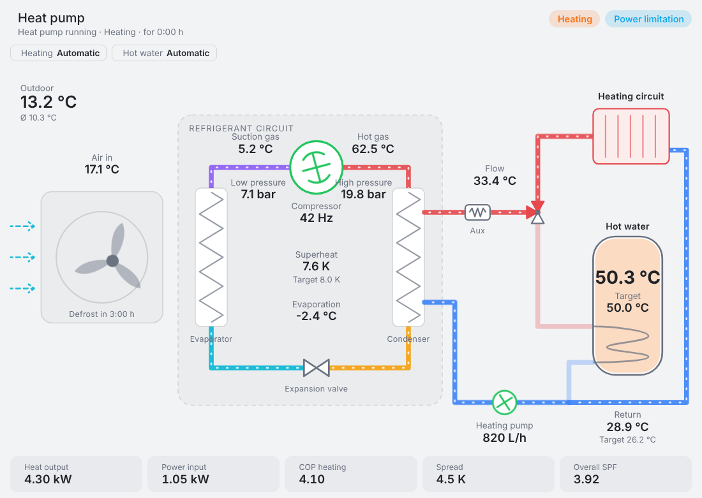
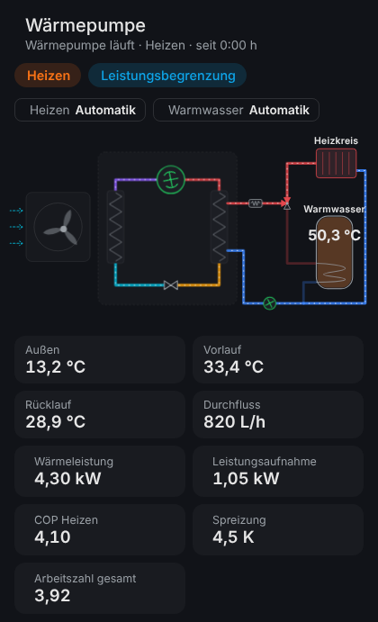

# Luxtronik Heatpump Card

An animated system-diagram card for Home Assistant, for heat pumps with a **Luxtronik controller** (Novelan, Alpha Innotec, Roth, Siemens, Buderus, …). Built for the [BenPru/luxtronik](https://github.com/BenPru/luxtronik) integration (`luxtronik2`) and inspired by the [Daikin/Rotex HPSU Dashboard](https://github.com/wrfz/daikin-rotex-hpsu-dashboard).





## Features

- **Heat source**: air (fan spins while the VBO output is on and stops while defrosting, plus a "defrost in …" countdown), ground loop or well, with inlet/outlet temperatures and source flow rate. Detected automatically from the heat pump model the integration reports (e.g. `LWC…`/`LD…`/`LP…`/`HMD 2` → air, `SW…`/`MSW…` → ground loop, `WW…`/`WZW…` → well). If the model does not name a source (`ERC`, …), the card falls back to: defrost valve entity present → air, otherwise ground loop. The luxtronik2 integration creates that entity on every unit, so the fallback usually says air — set `heat_source` if it guesses wrong. `heat_source` always overrides the detection.
- **Refrigerant circuit**: evaporator, compressor (frequency), condenser, expansion valve, suction gas, hot gas, high/low pressure, superheat (actual/target), evaporation temperature. Pipe animation reverses during defrost and the evaporator "frosts". Values are dimmed while the compressor is off, because they are only standstill readings.
- **Heating water**: flow, return and return target, circulation pump with flow rate, 3-way valve (shows whether the heating circuit or the DHW tank is being served), auxiliary heater (glows when active), room temperature.
  - *Which circuit is served*: decided by the 3-way valve / BUP entity if one is configured, otherwise by the operating state (`hot_water` → DHW tank, anything else → heating circuit).
  - *Is water moving*: any of HUP, ZUP or BUP running, or a flow rate above 50 L/h. Units that circulate via ZUP/BUP during DHW (HUP off) are therefore shown correctly.
- **DHW tank**: actual temperature (fill colour from cold to hot) and target.
- **Header**: operating state as a coloured chip, controller status lines and runtime, heating/DHW modes, utility lock (EVU), smart-grid status (only shown when not in normal operation, e.g. power limitation), fault banner.
- **Key figures**: heat output, power input, COP (heating or DHW depending on mode, only while the compressor runs; falls back to heat output ÷ power input when the COP sensor is missing and power input is above 50 W), spread (only while the pump runs), SPF over the last 12 months (Σ heat ÷ Σ energy input, heating + DHW, with the heating and DHW figures beside it, from Home Assistant's long-term statistics of the four counters; shows the number of days used when that is fewer than 330, e.g. while less than a year of history exists). The lifetime counters cannot be divided directly: the energy input counters only start counting with the firmware that added them, often years after the heat counters. Days on which a counter jumped by roughly its whole value (the controller briefly reporting 0) are left out.
- **Visual editor**: every setting and every entity mapping can be changed in the UI.
- **German and English**, following the Home Assistant language.
- **Narrow cards** (≤ 560 px, e.g. phones): the diagram shows symbols only and the main values move into tiles below.

Every value is clickable and opens the Home Assistant more-info dialog. Values whose entity does not exist are hidden automatically.

## Requirements

- Home Assistant 2024.4 or newer
- The [BenPru/luxtronik](https://github.com/BenPru/luxtronik) integration (`luxtronik2`)

## Installation

### HACS (custom repository)

1. HACS → ⋮ → **Custom repositories** → add `https://github.com/Gifford47/luxtronik-heatpump-card`, type **Dashboard**
2. Download "Luxtronik Heatpump Card" and reload your browser

### Manual

1. Copy `luxtronik-heatpump-card.js` to `/config/www/`
2. Settings → Dashboards → ⋮ → **Resources** → add resource:
   URL `/local/luxtronik-heatpump-card.js`, type **JavaScript module**
3. Reload your browser (clear the cache if needed)

## Configuration

### In the UI

Edit a dashboard → **Add card** → search for **Luxtronik Heat Pump**. The editor pre-fills every entity from the detected prefix. Each mapping is grouped by section (status, heat source, refrigerant circuit, heating water, hot water, power & energy) and can be changed to any other entity. Clearing a field hides that value on the card.

The diagram is designed for widths of 800 px and more, so a **panel** view or a full-width section works best.

### In YAML

Minimal – the entity prefix is detected automatically:

```yaml
type: custom:luxtronik-heatpump-card
```

As a panel view:

```yaml
views:
  - title: Heat pump
    path: heat-pump
    type: panel
    cards:
      - type: custom:luxtronik-heatpump-card
```

### Options

| Option | Default | Description |
|---|---|---|
| `title` | `Heat pump` / `Wärmepumpe` | Card title |
| `prefix` | auto-detected | Entity prefix, e.g. `luxtronik_123456_0123` (see below) |
| `heat_source` | `auto` | `auto`, `air`, `brine` (ground loop) or `water` (well) |
| `show_header` | `true` | Header with status, modes and chips |
| `show_refrigerant` | `true` | Values inside the refrigerant circuit |
| `show_kpis` | `true` | Key figures row at the bottom |
| `entities` | – | Override single entities, or hide them with `false` |

### Prefix

The integration names its entities `<domain>.<prefix>_<key>`. Newer installations use `luxtronik_<serial>` (e.g. `sensor.luxtronik_123456_0123_flow_in_temperature`), older ones often just `luxtronik`. The card looks for `sensor.luxtronik…_status` (together with `…_outdoor_temperature`) and uses that prefix; for renamed entities it falls back to any `sensor.<prefix>_flow_out_temperature_target` with a matching `…_status`. If nothing is found, `luxtronik` is used. Set `prefix` explicitly if you have several heat pumps or renamed your entities.

### Overriding entities

Example: use an external energy meter instead of the heat pump's own power reading, and hide the auxiliary heater:

```yaml
type: custom:luxtronik-heatpump-card
entities:
  power: sensor.shelly_heat_pump_power
  zwe: false
```

All keys and their default entities (`%` = prefix):

| Key | Default entity | Shown as |
|---|---|---|
| `status` | `sensor.%_status` | Status chip |
| `status_line_1` / `status_line_3` / `status_time` | `sensor.%_status_line_1` … | Status line, runtime, defrost countdown (attribute `Abtauen in …` of `status_time`) |
| `smart_grid` | `sensor.%_smart_grid_status` | Smart-grid chip |
| `evu` | `binary_sensor.%_evu_unlocked` | Utility lock |
| `disturbance` / `error_reason` | `binary_sensor.%_disturbance_output` / `sensor.%_error_reason` | Fault banner |
| `heating_mode` / `dhw_mode` | `select.%_heating_mode` / `select.%_dhw_mode` | Operating modes |
| `outdoor` / `outdoor_avg` | `sensor.%_outdoor_temperature(_average)` | Outdoor temperature |
| `source_in` / `source_out` | `sensor.%_heat_source_input/output_temperature` | Heat source in/out |
| `source_flow` | `sensor.%_heat_source_flow_rate` | Source flow rate (brine/water) |
| `source_pump` | `binary_sensor.%_pump_flow` | VBO: fan / brine / well pump |
| `defrost_valve` | `binary_sensor.%_defrost_valve` | Defrost |
| `compressor` | `binary_sensor.%_compressor` | Compressor running |
| `frequency` | `sensor.%_pump_frequency` | Compressor frequency |
| `hot_gas` / `suction` / `evaporation` | `sensor.%_hot_gas_temperature` / `…_suction_compressor_temperature` / `…_suction_evaporator_temperature` | Refrigerant circuit |
| `superheat` / `superheat_target` | `sensor.%_overheating(_target)_temperature` | Superheat |
| `high_pressure` / `low_pressure` | `sensor.%_high_pressure` / `sensor.%_low_pressure` | Pressures |
| `flow` | `sensor.%_flow_in_temperature` | **Flow** |
| `return` / `return_target` | `sensor.%_flow_out_temperature(_target)` | **Return** / return target |
| `flow_rate` | `sensor.%_heat_amount_flow_rate` | Heating water flow rate |
| `pump` | `binary_sensor.%_circulation_pump_heating` | Heating circulation pump (HUP) |
| `zup` | `binary_sensor.%_additional_circulation_pump` | Additional circulation pump (ZUP) |
| `dhw_valve` | `binary_sensor.%_dhw_recirculation_pump` | 3-way valve / BUP – leave empty to decide by operating state |
| `zwe` | `binary_sensor.%_additional_heat_generator` | Auxiliary heater |
| `room` / `room_target` | `sensor.%_room_thermostat_temperature(_target)` | Room temperature |
| `dhw` / `dhw_target` | `sensor.%_dhw_temperature` / `number.%_dhw_target_temperature` | DHW tank |
| `heat_output` / `power` | `sensor.%_current_heat_output` / `sensor.%_current_power_consumption` | Power |
| `cop_heating` / `cop_dhw` | `sensor.%_cop_heating` / `sensor.%_cop_dhw` | COP |
| `heat_amount_heating` / `heat_amount_dhw` | `sensor.%_heat_amount_heating` / `sensor.%_dhw_heat_amount` | SPF (heat) |
| `energy_heating` / `energy_dhw` | `sensor.%_heat_energy_input` / `sensor.%_dhw_energy_input` | SPF (electricity) |

> **Naming pitfalls in the integration**
> - `flow_in_temperature` is the **flow** temperature and `flow_out_temperature` is the **return** temperature. `flow_out_temperature_target` is the return target the Luxtronik controller regulates to.
> - `binary_sensor.*_pump_flow` is called "brine circulation pump" in the integration, but it is the Luxtronik output **VBO** (fan / well pump / brine pump). The heating circulation pump **HUP** is `circulation_pump_heating`.
> - `binary_sensor.*_dhw_recirculation_pump` is the **BUP** output (`ID_WEB_BUPout`, DHW pump / 3-way valve). In German it is just called "Umwälzpumpe" on the DHW device – the same name as the HUP.

## Entities disabled by default

The integration creates some entities disabled. To show them on the card, enable them under **Settings → Devices & services → Luxtronik → Entities**:

- `heat_source_input_temperature`, `heat_source_output_temperature` (heat source in/out)
- `current_heat_output`, `current_power_consumption` (heat output, power input, and the COP fallback)
- `pump_frequency` (compressor frequency)
- `outdoor_temperature_average` (average outdoor temperature below the outdoor value)

Which entities exist depends on model and firmware (e.g. pressures and frequency only on inverter models or newer firmware).

## License

[MIT](LICENSE)
